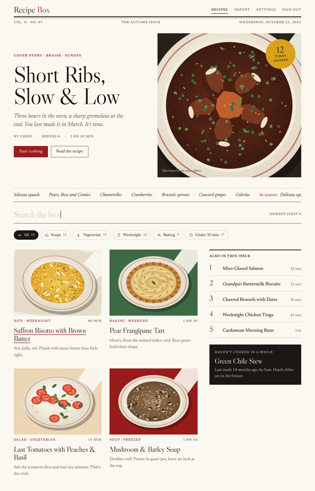
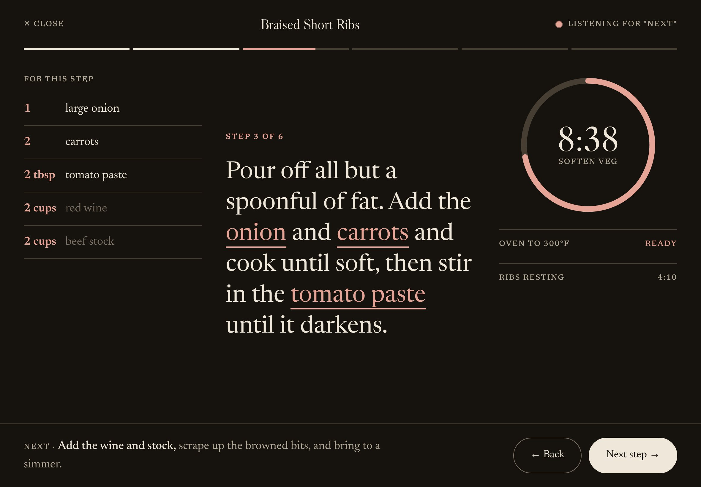

# Recipe Box

[](https://github.com/christopherjohnson1535/recipe-box/actions/workflows/ci.yml)

A household recipe website. Save recipes from **links** and **photos** (cookbook pages, handwritten cards,
screenshots — even a picture of the dish), find them by search and tags, and cook from an **iPad** with a
screen-stays-on cooking mode that also works offline.

> **Status:** Phase 1 (recipe box: accounts, editor, search, link import, household members) is done. Phase 2
> (photos and AI import, plus the October 2026 redesign) is starting; cooking mode and the PWA follow in Phase 3.
> Work is tracked as [issues](../../issues) by phase ([milestones](../../milestones)). See the [changelog](CHANGELOG.md).

| | |
|---|---|
| Backend | Rust · axum · sqlx · Postgres — `backend/` |
| Frontend | Next.js 16 · React 19 · Tailwind — `frontend/` |
| Run | Docker Compose: `db`, `api`, `web` (+ optional `caddy` for HTTPS) |
| Docs | [Docs index](#documentation) · [Wiki](../../wiki) |

### Proposed design (not built yet)
These are mockups from the [October 2026 redesign proposals](docs/design/redesign-2026-10/README.md), tracked in
issues #38 to #43. The app today looks like the editorial Phase 1 UI described in [docs/UI.md](docs/UI.md).




## Quick start
Needs Docker (Docker Desktop on Windows/macOS).
```sh
git clone https://github.com/christopherjohnson1535/recipe-box.git
cd recipe-box
cp .env.example .env          # set POSTGRES_PASSWORD at least
docker compose up -d --build
```
Open http://localhost:3000 — the first visit asks you to create the admin account. Add household members later in
Settings.

To use it from an iPad on your home network set `WEB_BIND=0.0.0.0` in `.env`. Installing it to the Home Screen,
offline use, the camera and keep-screen-awake need **HTTPS** — see [docs/DEPLOY.md](docs/DEPLOY.md).

## Photo import (optional AI)
Reading recipes from photos uses an AI vision model. Set `AI_PROVIDER=anthropic` and `ANTHROPIC_API_KEY` in `.env`.
Without it the app still works: a photo is saved next to an empty form to type in.

## Development
```sh
just setup    # dependencies, factory skills, git hooks (if lefthook is installed)
just check    # lint, format, type checks, tests and dependency audits (coverage and scans run in CI only)
just up       # the full stack at http://localhost:3000
```
Without `just`: API `cd backend && cargo run` (needs `DATABASE_URL`); web
`cd frontend && npm install && API_INTERNAL_URL=http://localhost:8080 npm run dev`.
See [CONTRIBUTING.md](CONTRIBUTING.md) for branches, PR titles and the definition of done. Security reports:
[SECURITY.md](SECURITY.md).

## Documentation
**Tutorials** (learn by doing)
- [Getting started](https://github.com/christopherjohnson1535/recipe-box/wiki/Getting-Started) · [Using it on an iPad](https://github.com/christopherjohnson1535/recipe-box/wiki/Using-on-iPad) (wiki; sources in `docs/wiki/`)

**How-to guides** (get a task done)
- [Deploy with HTTPS](docs/DEPLOY.md) · [Back up and restore](docs/wiki/Backup-and-Restore.md)
- [Import recipes](docs/wiki/Importing-Recipes.md) · [Photo import with AI](docs/wiki/AI-Photo-Import.md) · [Household members](docs/wiki/Household-Members.md)
- [Contribute](CONTRIBUTING.md) · [Test](docs/TESTING.md) · [Theme the UI](docs/THEMING.md) · [Develop](docs/wiki/Development.md)

**Reference** (look things up)
- [API contract](docs/API.md) · [Client SDKs](docs/SDK.md) · [Requirements](docs/REQUIREMENTS.md) · [Spec and data model](docs/SPEC.md) · [UI guide](docs/UI.md) · [Changelog](CHANGELOG.md) · [Security policy](SECURITY.md)

**Explanation** (understand why)
- [Architecture decision records](docs/adr/README.md) · [Software factory](docs/FACTORY.md) · [Wiki: Architecture](docs/wiki/Architecture.md) · [Roadmap](docs/wiki/Roadmap.md)
- [Redesign proposals](docs/design/redesign-2026-10/README.md)

## Backup
`sh scripts/backup.sh` → `backups/<time>/` · `sh scripts/restore.sh backups/<time>`

## Licence
MIT — see [LICENSE](LICENSE).
